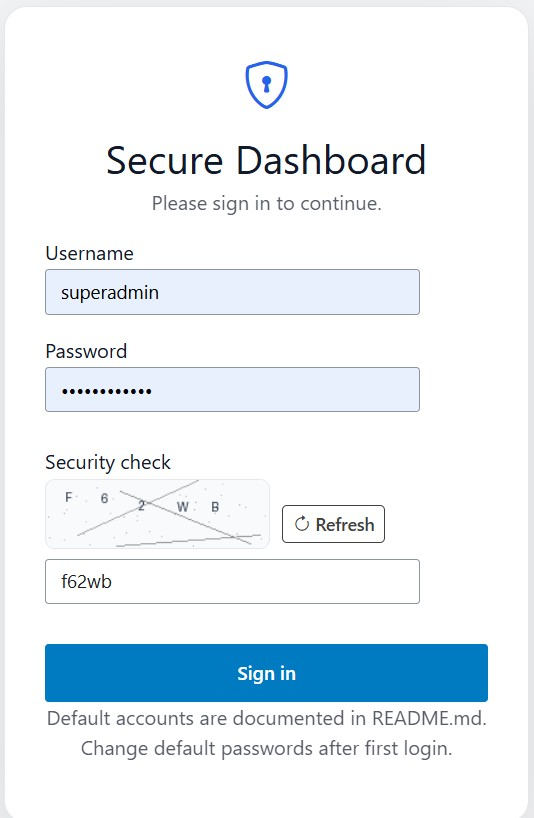
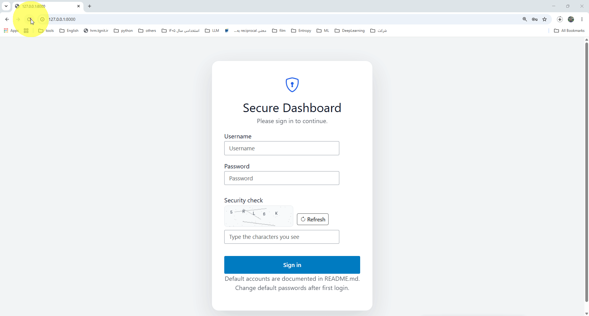

# Python Shiny Dashboard

A customizable Shiny for Python dashboard featuring role-based authentication,
 SQLite user storage, optional account expiration, self-service password changes,
  12 selectable themes, and hierarchical RBAC decorators.


**🔗 Live Demo:** [https://masoudfaridi.shinyapps.io/pyshiny/](https://masoudfaridi.shinyapps.io/pyshiny/)

<p align="center">
  
</p>

<p align="center">
  
</p>

## Project Structure

```text
pyshiny/
├── 00_create_files/           # Step 0 – prepare runtime environment
│   └── bootstrap.py           # Creates db/, cleans auth.db, makes docker/.env
├── 01_requirements/           # Step 1 – auto-update requirements.txt
│   └── update_requirements.py # Scans all .py files and refreshes dependencies
├── app.py                     # Main Shiny application and navigation shell
├── i18n.py                    # English / Persian UI strings + the APP_LANG switch
├── requirements.txt           # Python dependencies (auto-maintained)
├── auth/
│   ├── __init__.py            # Public auth API re-exports
│   ├── core.py                # Authentication, password hashing, expiration, RBAC
│   └── captcha.py             # Offline image CAPTCHA generator
├── db/                        # SQLite database (created on first run)
│                              #   auth.db is NEVER shipped – see .gitignore
├── docker/
│   ├── Dockerfile             # Image build (Python 3.12-slim + deps)
│   ├── entrypoint.sh          # Starts Shiny on 0.0.0.0:$PORT
│   ├── docker-compose.yml     # One-command build + run, port via $PORT
│   ├── .env.example           # Copy to .env to set a default PORT
│   ├── run.sh                 # One-command build + run without compose
│   └── README.md              # Docker quick reference
├── static/
│   ├── css/
│   │   └── styles.css         # Dashboard, authentication, and theme styles
│   └── js/
│       └── custom.js          # Sidebar, theme picker, login Enter, user actions
└── tabs/
    ├── tab_01.py              # Dashboard v1 (Superadmin)
    ├── tab_02.py              # Dashboard v2 (Admin+)
    ├── tab_03.py              # Dashboard v3 (User+)
    ├── tab_04.py              # Components (Guest+)
    ├── tab_05.py              # Widgets
    ├── tab_06.py              # Tables
    ├── tab_account.py         # Self-service account and password management
    ├── tab_users.py           # Superadmin-only user management
    ├── HOW_TO_ADD_A_TAB.md    # Every place to edit when adding a tab
    ├── MODULES.md             # How Shiny modules work (the technique used by the tabs)
    └── examples/              # 15 copy-ready module examples (ex01 ... ex15) + README
```

## Font picker

A **Font** button sits next to the theme control. It exposes three roles:

- **Body / UI** – main interface text
- **Headings** – titles and brand text (`Inherit` = same as Body)
- **Navigation** – sidebar links (`Inherit` = same as Body)

Available families depend on the text direction, which follows `APP_LANG`
(see [Language and direction](#language-and-direction-english--فارسی)):

- **ltr** → Inter, Roboto, IBM Plex Sans, Source Sans 3, System UI  
  (files under `static/fonts/ltr/`)
- **rtl** → Vazirmatn, Shabnam, Samim, Sahel, BYekan, System UI  
  (Farsi-digit variants under `static/fonts/rtl/`)

Choices are stored in `localStorage` and re-applied after refresh.

## Language and direction (English / فارسی)

The fixed texts of the **login screen**, the **main page** (top bar, sidebar,
theme and font pickers), **My Account** and **User Management** exist in two
languages. The demo tabs (`tab_01` … `tab_06`) are placeholders you replace by
hand, so they are deliberately not translated.

All strings live in one dictionary, `STRINGS`, in `i18n.py`:

```python
STRINGS = {
    "en": {"login_title": "Secure Dashboard", "login_button": "Sign in", ...},
    "fa": {"login_title": "داشبورد امن",      "login_button": "ورود",     ...},
}
```

### Switching to Persian (RTL)

Change **one line** – `APP_LANG` in `i18n.py`:

```python
APP_LANG = "fa"   # "en" = English / LTR (default),  "fa" = Persian / RTL
```

…or, without editing any file, set the environment variable (it wins over the
line above):

```bash
APP_LANG=fa shiny run app.py --reload          # Linux / macOS
set APP_LANG=fa && shiny run app.py --reload   # Windows (cmd)
APP_LANG=fa docker compose up --build -d       # Docker
```

That single setting also switches the text direction (`dir="rtl"`), the
Bootstrap stylesheet (`bootstrap.rtl.css`), the `<html lang>` attribute, the
font list (`static/fonts/rtl/`: Vazirmatn, Shabnam, Samim, Sahel, BYekan) and
the messages raised by `auth/core.py`. **Nothing has to be commented or
uncommented in `app.py` any more** (older versions of this project required
swapping two `app_ui` blocks by hand).

Note: the language is chosen when the server starts, so restart the app after
changing it (`--reload` does this for you when `i18n.py` is edited).

### Using the strings in your own code

```python
from i18n import t, role_label

ui.h3(t("account_title"))                 # "My Account"  /  "حساب کاربری من"
t("login_locked", remaining=30)           # placeholders use str.format
role_label("superadmin")                  # "Superadmin"  /  "مدیر کل"
```

A key that is missing in the active language falls back to English; a key
missing everywhere is shown as the key itself, so typos are easy to spot.
Strings used by the browser (theme names, font labels, the delete confirmation)
are passed to `static/js/custom.js` automatically as `window.APP_I18N`.

### Adding another language

1. In `i18n.py`, copy the whole `"en"` block inside `STRINGS` and rename it
   (for example `"ar"`).
2. Translate the values. Keep the `{placeholders}` exactly as they are.
3. If the language is right-to-left, make sure its code is in `RTL_LANGS`.
4. Run it with `APP_LANG=ar`. `tests/test_i18n.py` checks that every language
   has the same keys and placeholders.

### Reference: all translated strings

<details>
<summary>Click to expand the full English ↔ فارسی table (generated from <code>i18n.py</code>)</summary>

**Roles / نقش‌ها**

| Key | English | فارسی |
|---|---|---|
| `role_guest` | Guest | مهمان |
| `role_user` | User | کاربر |
| `role_admin` | Admin | مدیر |
| `role_superadmin` | Superadmin | مدیر کل |

**Common / عمومی**

| Key | English | فارسی |
|---|---|---|
| `yes` | Yes | بله |
| `no` | No | خیر |
| `never` | Never | هرگز |
| `username` | Username | نام کاربری |
| `password` | Password | رمز عبور |
| `access_level` | Access level | سطح دسترسی |
| `confirm_password` | Confirm password | تکرار رمز عبور |
| `confirm_new_password` | Confirm new password | تکرار رمز عبور جدید |
| `set_expiry` | Set an expiration date | تعیین تاریخ انقضا |
| `expiry_date` | Expiration date | تاریخ انقضا |
| `superadmin_no_expiry` | Superadmin accounts do not expire. | حساب مدیر کل منقضی نمی‌شود. |

**Login screen / صفحه‌ی ورود**

| Key | English | فارسی |
|---|---|---|
| `login_title` | Secure Dashboard | داشبورد امن |
| `login_subtitle` | Please sign in to continue. | برای ادامه لطفاً وارد شوید. |
| `login_security_check` | Security check | بررسی امنیتی |
| `login_captcha_placeholder` | Type the characters you see | نویسه‌های داخل تصویر را وارد کنید |
| `login_captcha_alt` | CAPTCHA | کپچا |
| `login_refresh` | Refresh | تازه‌سازی |
| `login_button` | Sign in | ورود |
| `login_hint` | Default accounts are documented in README.md. Change default passwords after first login. | حساب‌های پیش‌فرض در فایل README.md توضیح داده شده‌اند. پس از اولین ورود، رمز عبور پیش‌فرض را تغییر دهید. |
| `login_invalid` | Invalid username or password, inactive account, or expired account. | نام کاربری یا رمز عبور نادرست است، یا حساب غیرفعال یا منقضی شده است. |
| `login_locked` | Too many failed attempts. Try again in {remaining} seconds. | تعداد تلاش‌های ناموفق بیش از حد مجاز است. {remaining} ثانیه دیگر دوباره تلاش کنید. |
| `login_captcha_invalid` | Invalid security check. Please try again. | بررسی امنیتی نادرست بود. لطفاً دوباره تلاش کنید. |

**Main page – top bar / صفحه‌ی اصلی – نوار بالا**

| Key | English | فارسی |
|---|---|---|
| `brand` | Python Shiny Dashboard | داشبورد Python Shiny |
| `logout` | Logout | خروج |
| `font_button` | Font | فونت |
| `font_aria` | Choose fonts | انتخاب فونت |
| `font_menu_title` | Fonts | فونت‌ها |
| `font_body` | Body / UI | متن / رابط کاربری |
| `font_headings` | Headings | عنوان‌ها |
| `font_navigation` | Navigation | منوی ناوبری |
| `font_inherit` | Inherit (Body) | همانند متن اصلی |
| `font_system` | System UI | فونت سیستم |
| `theme_aria` | Choose theme | انتخاب تم |
| `theme_light_title` | Light themes | تم‌های روشن |
| `theme_dark_title` | Dark themes | تم‌های تیره |
| `theme_light_suffix` | Light theme | تم روشن |
| `theme_dark_suffix` | Dark theme | تم تیره |

**Main page – sidebar / صفحه‌ی اصلی – منوی کناری**

| Key | English | فارسی |
|---|---|---|
| `nav_dashboard` | Dashboard | داشبورد |
| `nav_account` | My Account | حساب کاربری من |
| `nav_users` | User Management | مدیریت کاربران |

**Theme names / نام تم‌ها**

| Key | English | فارسی |
|---|---|---|
| `theme_light-blue` | Ocean Blue | آبی اقیانوسی |
| `theme_light-green` | Fresh Green | سبز شاداب |
| `theme_light-purple` | Soft Purple | بنفش ملایم |
| `theme_light-orange` | Warm Orange | نارنجی گرم |
| `theme_light-teal` | Calm Teal | فیروزه‌ای آرام |
| `theme_light-rose` | Elegant Rose | صورتی ظریف |
| `theme_dark-slate` | Midnight Slate | سربی نیمه‌شب |
| `theme_dark-ocean` | Deep Ocean | اقیانوس عمیق |
| `theme_dark-emerald` | Emerald Night | شب زمردی |
| `theme_dark-purple` | Royal Night | شب سلطنتی |
| `theme_dark-amber` | Amber Night | شب کهربایی |
| `theme_dark-rose` | Rose Night | شب رز |

**My Account / حساب کاربری من**

| Key | English | فارسی |
|---|---|---|
| `account_title` | My Account | حساب کاربری من |
| `account_intro` | Change your own password. This is available to every authenticated user. | رمز عبور خود را تغییر دهید. این امکان برای همه کاربرانِ واردشده در دسترس است. |
| `account_change_heading` | Change password | تغییر رمز عبور |
| `account_current_password` | Current password | رمز عبور فعلی |
| `account_new_password` | New password | رمز عبور جدید |
| `account_change_button` | Change password | تغییر رمز عبور |
| `account_tips_heading` | Password tips | نکات رمز عبور |
| `account_tip_length` | Use at least 8 characters. | حداقل ۸ نویسه استفاده کنید. |
| `account_tip_mix` | Mix letters, numbers, and symbols. | ترکیبی از حروف، اعداد و نمادها به کار ببرید. |
| `account_tip_reuse` | Avoid reusing passwords from other sites. | از رمزهای عبور سایت‌های دیگر دوباره استفاده نکنید. |
| `account_mismatch` | New password and confirmation do not match. | رمز عبور جدید و تکرار آن یکسان نیستند. |
| `account_changed` | Password changed successfully. | رمز عبور با موفقیت تغییر کرد. |

**User Management / مدیریت کاربران**

| Key | English | فارسی |
|---|---|---|
| `users_title` | User Management | مدیریت کاربران |
| `users_intro` | Only Superadmin users can create, edit, and delete accounts. | فقط مدیر کل می‌تواند حساب‌ها را ایجاد، ویرایش و حذف کند. |
| `users_create_heading` | Create user | ایجاد کاربر |
| `users_create_button` | Create user | ایجاد کاربر |
| `users_existing_heading` | Existing users | کاربران موجود |
| `users_existing_hint` | Use Change to edit an account in a popup, or Delete to remove it. | برای ویرایش حساب در یک پنجره‌ی بازشو، «ویرایش» و برای حذف آن، «حذف» را بزنید. |
| `users_change` | Change | ویرایش |
| `users_delete` | Delete | حذف |
| `users_col_actions` | Actions | عملیات |
| `users_col_id` | ID | شناسه |
| `users_col_username` | Username | نام کاربری |
| `users_col_role` | Role | نقش |
| `users_col_active` | Active | فعال |
| `users_col_expires` | Expires | انقضا |
| `users_col_created` | Created | تاریخ ایجاد |
| `users_create_mismatch` | Password and confirmation do not match. | رمز عبور و تکرار آن یکسان نیستند. |
| `users_created` | User created successfully. | کاربر با موفقیت ایجاد شد. |
| `users_updated` | User updated successfully. | کاربر با موفقیت ویرایش شد. |
| `users_deleted` | User deleted successfully. | کاربر با موفقیت حذف شد. |
| `users_not_found` | User not found. | کاربر پیدا نشد. |
| `users_exists` | This username already exists. | این نام کاربری از قبل وجود دارد. |
| `users_denied_create` | Access denied: only Superadmin can create users. | دسترسی غیرمجاز: فقط مدیر کل می‌تواند کاربر ایجاد کند. |
| `users_denied_edit` | Access denied: only Superadmin can edit users. | دسترسی غیرمجاز: فقط مدیر کل می‌تواند کاربر را ویرایش کند. |
| `users_denied_delete` | Access denied: only Superadmin can delete users. | دسترسی غیرمجاز: فقط مدیر کل می‌تواند کاربر را حذف کند. |
| `users_confirm_delete` | Delete user "{username}"? This cannot be undone. | کاربر «{username}» حذف شود؟ این کار قابل بازگشت نیست. |

**User Management – edit popup / پنجره‌ی ویرایش**

| Key | English | فارسی |
|---|---|---|
| `edit_title` | Edit user: {username} | ویرایش کاربر: {username} |
| `edit_active` | Active account | حساب فعال |
| `edit_new_password` | New password (leave blank to keep current password) | رمز عبور جدید (برای حفظ رمز فعلی خالی بگذارید) |
| `edit_save` | Save changes | ذخیره تغییرات |
| `edit_delete` | Delete user | حذف کاربر |
| `edit_cancel` | Cancel | انصراف |
| `edit_mismatch` | New password and confirmation do not match. | رمز عبور جدید و تکرار آن یکسان نیستند. |

**Validation errors (auth/core.py) / پیام‌های خطا**

| Key | English | فارسی |
|---|---|---|
| `field_password` | Password | رمز عبور |
| `field_new_password` | New password | رمز عبور جدید |
| `err_username_format` | Username must be 3–32 characters and contain only letters, numbers, underscores, or hyphens. | نام کاربری باید بین ۳ تا ۳۲ نویسه باشد و فقط شامل حروف انگلیسی، اعداد، زیرخط (_) یا خط تیره (-) باشد. |
| `err_password_required` | {field} is required. | {field} الزامی است. |
| `err_password_min` | {field} must contain at least {n} characters. | {field} باید حداقل {n} نویسه داشته باشد. |
| `err_password_max` | {field} must contain at most {n} characters. | {field} باید حداکثر {n} نویسه داشته باشد. |
| `err_password_complexity` | {field} must contain at least one letter and one number. | {field} باید حداقل یک حرف و یک عدد داشته باشد. |
| `err_expiry_format` | Expiration date must use YYYY-MM-DD format. | تاریخ انقضا باید با قالب YYYY-MM-DD وارد شود. |
| `err_invalid_role` | Invalid role. | نقش نامعتبر است. |
| `err_auth_required` | Authentication is required. | ورود به سامانه الزامی است. |
| `err_current_password` | Current password is incorrect. | رمز عبور فعلی نادرست است. |
| `err_user_not_found` | User not found. | کاربر پیدا نشد. |
| `err_last_superadmin` | At least one active Superadmin must remain. | دست‌کم یک مدیر کل فعال باید باقی بماند. |
| `err_delete_self` | You cannot delete the account you are currently using. | نمی‌توانید حسابی را که با آن وارد شده‌اید حذف کنید. |
| `err_delete_last_superadmin` | The last active Superadmin cannot be deleted. | آخرین مدیر کل فعال را نمی‌توان حذف کرد. |

</details>

## Installation


Follow these steps in order after extracting the archive.

### Step 0 – Prepare the runtime environment

```bash
python 00_create_files/bootstrap.py
```

This script:

- Creates the `db/` directory if it does not exist.
- Removes any leftover `db/auth.db` (the database must be generated on first
  run by `auth.core.init_db()`, never shipped).
- Creates `docker/.env` from `docker/.env.example` when missing.
- Performs basic sanity checks on the project layout.
- Prints the next commands you should run.

### Step 1 – Refresh requirements.txt

```bash
python 01_requirements/update_requirements.py
```

What the script does:

- Walks the whole project tree and parses every `.py` file with the AST.
- Detects both `import package` and `from package import ...` statements.
- Maps import names to the correct PyPI package (e.g. `PIL` → `Pillow`).
- Skips the Python standard library and local packages (`auth`, `tabs`, …).
- Never creates duplicate entries.
- Preserves any version pins that are already present.
- Adds newly discovered third-party packages with sensible minimum versions.

Dry-run mode (show changes without writing the file):

```bash
python 01_requirements/update_requirements.py --dry-run
```

After the script finishes, `requirements.txt` typically looks like:

```text
shiny>=1.4
Pillow>=10.0
matplotlib>=3.7
numpy>=1.24
```

### Step 2 – Install the packages

```bash
pip install -r requirements.txt
```

Current core dependencies:

| Package      | Purpose                              |
|--------------|--------------------------------------|
| shiny        | Web application framework            |
| Pillow       | Offline CAPTCHA image generation     |
| numpy        | Numerical arrays used by the charts  |
| matplotlib   | Histogram and plot rendering         |

## Run the Application

Start the Shiny application with:

```bash
shiny run app.py --reload
```

Then open the address printed by the terminal, usually:

```text
http://127.0.0.1:8000
```

## Docker

The whole project can be built and run in a container with one command --
no local Python install needed. Everything lives in the `docker/` folder.

### Quickest path: docker compose

```bash
cd docker
docker compose up --build -d
```

That builds the image and starts the dashboard on **port 8000**:

```text
http://localhost:8000
```

Persian (RTL) interface instead of English: `APP_LANG=fa docker compose up --build -d`.

Want a different port? Set `PORT` -- nothing else to edit, host and
container both pick it up automatically:

```bash
PORT=9000 docker compose up --build -d
# -> http://localhost:9000
```

(Or copy `docker/.env.example` to `docker/.env` and set `PORT` there once,
then just run `docker compose up --build -d` every time.)

Stop it with:

```bash
docker compose down
```

### Alternative: plain `docker`, no compose

If you don't have `docker compose`, run this from the project root instead
-- it builds and starts the container in one step:

```bash
bash docker/run.sh          # port 8000
bash docker/run.sh 9000     # port 9000
```

### What the image does

- Base image: `python:3.12-slim`, with `fonts-dejavu-core` installed so the
  login CAPTCHA renders with a real TrueType font instead of Pillow's tiny
  fallback bitmap font.
- Runs as a non-root user (`appuser`) inside the container.
- `db/` (the SQLite file with all accounts) is mounted as a volume from the
  project root, **not** baked into the image. `auth/core.py` creates and
  seeds it automatically the first time the container starts, and it then
  persists across restarts, rebuilds, and `docker compose down` / `up`.
- A `HEALTHCHECK` pings the dashboard every 30s so `docker ps` and
  orchestrators (Swarm, Kubernetes, etc.) can tell if it's actually serving
  requests, not just that the process is alive.
- The internal port is controlled by a single `PORT` environment variable
  (default `8000`), read by `docker/entrypoint.sh` at startup. Both
  `docker/run.sh` and `docker/docker-compose.yml` publish the host port and
  set this env var together from one value, so you only ever specify the
  port once, in one place.

### Useful commands

```bash
docker logs -f pyshiny      # follow logs
docker stop pyshiny         # stop (run.sh-started container)
docker compose down                          # stop (compose-started container)
docker compose up --build -d                 # rebuild after code changes
```

See `docker/README.md` for a short reference to every file in that folder.

## Authentication

Authentication is required before the dashboard can be accessed.
The application uses four hierarchical roles:

```text
Superadmin
    ↓
Admin
    ↓
User
    ↓
Guest
```

A higher role automatically inherits all permissions from lower roles.

## Security Notes

The authentication system includes several security protections:

- Session authorization is revalidated against SQLite before protected actions.
- Passwords are hashed with PBKDF2-HMAC-SHA256 and per-password salts.
- Login attempts are rate-limited after repeated failures.
- The SQLite database is generated automatically on first run and `db/auth.db`
  should never be committed to the repository.
- Change all default passwords before using the application in a real environment.

For production deployment, additional infrastructure-level protections such as
shared rate limiting and security headers may be required.

## Security controls

The login form includes an **offline image CAPTCHA** (no external network service).

Additional protections:

- Constant-time hash comparison and a dummy verify path for unknown users
- Username format limits and password length limits
- Stronger password rules for self-service password changes
  (Superadmin may still assign simpler passwords when creating/editing users)

## Account Expiration

Superadmin accounts never expire. Admin, User, and Guest accounts can optionally
have an expiration date. The expiration date is inclusive, so the account remains
usable through the specified date and becomes unavailable starting the following day.

Expired accounts cannot log in, and protected backend functions also reject expired
sessions.


## Default Accounts

The SQLite database is initialized automatically on first startup.
The following accounts are seeded only when they do not already exist:

| Username | Password | Role | Expiration |
|---|---|---|---|
| `superadmin` | `ChangeMe123!` | Superadmin | Never |
| `admin` | `Admin123!` | Admin | None |
| `user` | `User123!` | User | None |
| `guest` | `Guest123!` | Guest | None |

Passwords are not stored as plaintext. The application uses PBKDF2-HMAC-SHA256
with a per-password random salt.

Change the default passwords before using the application in a real environment.

## Self-Service Password Change

Every authenticated user can change their own password from the `My Account`
page. The current password must be verified, and the new password must be entered
twice and contain at least 8 characters.

This functionality is available to every authenticated role, including Guest users.

## RBAC Decorators

The project exposes four decorators from the `auth` package (`auth/core.py`):

```python
from auth import superadmin, admin, user, guest

@superadmin
def delete_user(...):
    ...

@admin
def manage_report(...):
    ...

@user
def run_analysis(...):
    ...

@guest
def view_dashboard(...):
    ...
```

### Permission Matrix

| Decorator | Superadmin | Admin | User | Guest |
|---|---:|---:|---:|---:|
| `@superadmin` | Yes | No | No | No |
| `@admin` | Yes | Yes | No | No |
| `@user` | Yes | Yes | Yes | No |
| `@guest` | Yes | Yes | Yes | Yes |

All four decorators require an authenticated user. `@guest` represents the
lowest authenticated permission level; it does not mean anonymous access.

If a user does not have the required permission, the decorator raises
`PermissionError` before the protected function is executed.

## User Management

The `User Management` page is visible only to Superadmin users.
A Superadmin can create, edit, and delete accounts.

### Create User

A Superadmin can provide:

- Username
- Password
- Access level
- Optional expiration date for Admin, User, or Guest accounts

Superadmin accounts always have no expiration date.

### Edit User

A Superadmin can change:

- Username
- Access level
- Active status
- Password
- Optional expiration date

The application prevents the last active Superadmin account from being
demoted, disabled, or deleted.

### Delete User

A Superadmin can delete other accounts.
The currently logged-in account cannot delete itself.
The last active Superadmin account cannot be deleted.

The server-side `create_user()`, `update_user()`, `delete_user()`, and
`list_users()` functions are protected with `@superadmin`.

## SQLite Database

The database file is:

```text
db/auth.db
```

The main table is:

```sql
users
```

Its fields include:

- `id`
- `username`
- `password_hash`
- `role`
- `is_active`
- `expire_date`
- `created_at`

The application automatically migrates an older database file by adding the
`expire_date` column when necessary.

Existing users are never overwritten by the initial seed operation.

## Themes

The dashboard includes 12 selectable themes:

### Light Themes

1. Ocean Blue
2. Fresh Green
3. Soft Purple
4. Warm Orange
5. Calm Teal
6. Elegant Rose

### Dark Themes

1. Midnight Slate
2. Deep Ocean
3. Emerald Night
4. Royal Night
5. Amber Night
6. Rose Night

The theme picker is located in the top-right area of the dashboard.
The selected theme is stored in browser `localStorage`, so it remains selected
after a page refresh.

### How widgets follow the theme

Shiny and Bootstrap ship widgets with hard-coded light colours. Two things make
**every** widget follow the selected theme:

1. `static/js/custom.js` sets `data-bs-theme="light|dark"` on `<html>` together
   with `data-theme`, so Bootstrap 5.3's own dark palette applies to anything
   not styled by hand. Dark themes also set `color-scheme: dark` (native
   scrollbars, spin buttons, date inputs, `<select>` popups).
2. The **THEME BRIDGE** section at the end of `static/css/styles.css` maps the
   widget classes to the theme variables (`--surface`, `--text`, `--border`,
   `--accent` ...). It covers text / number / password / textarea inputs
   (`.shiny-input-number`, `.form-control` ...), `select` and selectize,
   checkbox / radio / switch, sliders (`.irs--shiny`), the date picker, file
   input, buttons (`.btn-default`, `.btn-primary`, `.action-label`, download
   links), cards, accordion, nav tabs / pills, tables, modals, notifications,
   dropdowns, popovers, tooltips, list groups, progress bars, code output,
   scrollbars and browser autofill.

If a new widget looks wrong in a theme, inspect its class in the browser and add
one rule to the THEME BRIDGE using the theme variables (never a fixed colour).
`tests/test_theme_coverage.py` checks that all 12 themes define the required
variables and that the widget selectors above stay styled. Note that matplotlib
figures are images and keep their own (white) background.

### Sidebar toggle

The top bar has a large menu button (`#sidebar-toggle-btn`, 44 px). The layout
is plain HTML/CSS (`<aside id="app-sidebar">` + `<main class="app-main">`, no
bslib `layout_sidebar`): `setupSidebarToggle` in `custom.js` only adds or removes
the class `sidebar-collapsed` on `.app-shell`, and keeps `aria-expanded` in sync.

* Desktop: the choice (open / closed) is remembered in `localStorage`.
* Phones (< 768 px): the menu starts closed, slides over the content, and closes
  when you tap outside it or pick a page.
* RTL/LTR work automatically (logical CSS properties).
* The content (`.app-main`) uses all remaining space; `.tab-pane-content` is
  full-width and fills the available height.

### Login CAPTCHA

The CAPTCHA image is drawn at 2x resolution with a bundled font
(`auth/fonts/DejaVuSans-Bold.ttf`, Bitstream Vera / DejaVu licence in
`auth/fonts/DejaVu-LICENSE.txt`), so the characters are large and identical on
Windows, Linux and slim Docker images. Size is set by `CAPTCHA_WIDTH` /
`CAPTCHA_HEIGHT` in `auth/captcha.py` and must match `.login-captcha-image` in
`styles.css`.

## Adding a New Tab

Detailed guides live in `tabs/`: [`HOW_TO_ADD_A_TAB.md`](tabs/HOW_TO_ADD_A_TAB.md)
(every place to edit), [`MODULES.md`](tabs/MODULES.md) (how Shiny modules work)
and [`tabs/examples/`](tabs/examples/README.md) (15 copy-ready module examples).

Quick version:

1. Copy an existing module from `tabs/`.
2. Give the new module a unique `NAV_ID`.
3. Set `NAV_LABEL` to the text shown in the sidebar (or `t("some_key")` after
   adding the key to both languages in `i18n.py`, if the tab should be bilingual).
4. Set `NAV_ICON` to a Bootstrap Icons class for top-level items.
5. Set `NAV_GROUP` to `dashboard` to place the tab inside the Dashboard group,
   or use `None` for a top-level item.
6. Set `NAV_MIN_ROLE` to the minimum role required to see the page.
7. In `app.py`: import the module, add it to the `TABS` list, **and call its
   `server()` once inside `def server(...)`** (e.g. `tab_07.server()`).

Example:

```python
NAV_ID = "tab_07"
NAV_LABEL = "Analytics"
NAV_ICON = "bi-bar-chart"
NAV_GROUP = None
NAV_MIN_ROLE = "user"
```

With `NAV_MIN_ROLE = "user"`, Superadmin, Admin, and User accounts can access
the page, while Guest accounts cannot.

## Adding Protected Functions

Import the appropriate decorator and place it directly above the function:

```python
from auth import admin

@admin
def export_report(report_id):
    # Only Admin and Superadmin users can execute this function.
    return generate_report(report_id)
```

This approach keeps authorization rules close to the functions they protect
and avoids repeating manual role checks throughout the application.

## Next Steps

Planned improvements for future releases:

- **Session timeout / idle auto-logout**  
  Automatically log the user out after a period of inactivity (e.g. 10 minutes).  
  This will improve security on shared or unattended workstations.

- **User activity logs in the User Manager**  
  Record and display important user actions (login, logout, password changes,  
  role updates, account creation/deletion) inside the User Manager page so  
  Superadmins can audit account activity.